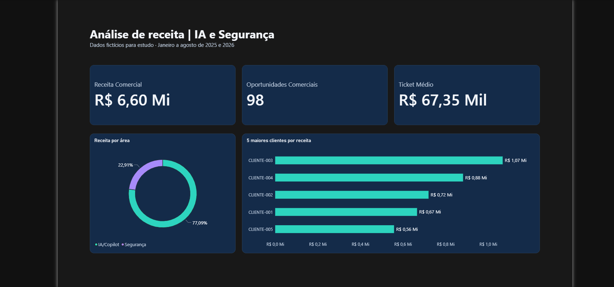
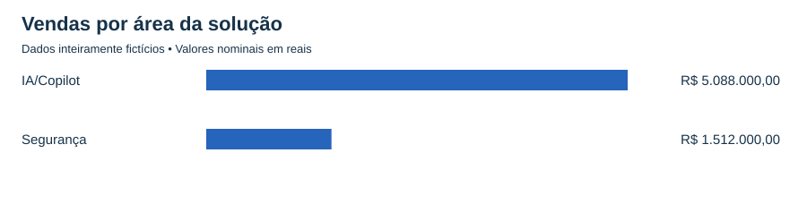

# Análise comercial de soluções de IA e Segurança

[](https://github.com/viictorgabriel/revenue-sales-analysis/actions/workflows/testes.yml)   

Projeto de portfólio de Victor Souza: preparação de dados, consultas SQL e análise exploratória de oportunidades ganhas.

**Estudo simulado com dados inteiramente fictícios.** A pergunta de negócio foi inspirada em um contexto de vendas de tecnologia. Este repositório não contém exportações do CRM, nomes de clientes, identificadores ou valores da empresa. Os resultados não devem ser apresentados como conquistas profissionais reais.

## Resumo executivo

Analisei 120 registros de vendas ganhas de soluções de IA (Copilot) e Segurança para descobrir onde o valor das vendas se concentra. Das 98 oportunidades comerciais, que somam **R$ 6,6 milhões** com ticket médio de R$ 67,3 mil, os principais achados são:

- **Clientes com as duas frentes concentram o valor.** 44% dos clientes têm oportunidades em Copilot e em Segurança, e esse grupo soma **73% das vendas**. É uma descrição da carteira, não prova de que uma venda levou à outra.
- **IA puxa o valor.** Copilot responde por **77% das vendas**, com ticket médio de R$ 87,7 mil, 2,3 vezes o de Segurança (R$ 37,8 mil).
- **A carteira é concentrada.** Os cinco maiores clientes somam **59% das vendas**, o que pede planos de relacionamento dedicados para essas contas.
- **O período mais recente vendeu menos.** De janeiro a agosto, as vendas caíram **21%** de 2025 para 2026 (R$ 3,68 mi para R$ 2,92 mi).



**Ferramentas:** Python (somente biblioteca padrão), SQL em SQLite, Power BI e testes automatizados de qualidade de dados. Detalhes no [relatório de conclusões](reports/resultados.md).

## Pergunta de negócio

Quais soluções e clientes concentram o valor das vendas ganhas e como esse valor se distribui em períodos comparáveis?

O público da análise é uma liderança comercial ou de Customer Success que precisa decidir quais ofertas investigar e quais relacionamentos acompanhar mais de perto.

## Entregas

- Base pública sintética e gerador reproduzível.
- Validação de identificadores, datas, valores e classificação.
- Consultas SQL executadas em SQLite pelo Python.
- Vendas, quantidade, ticket médio e concentração de clientes.
- Gráficos e [relatório de conclusões](reports/resultados.md).



## Como reproduzir

Requisito: Python 3.10 ou superior. Apenas bibliotecas padrão; não há pacotes para instalar. Abra o terminal na pasta deste projeto e execute:

```bash
python src/gerar_dados.py
python src/analisar.py
python -m unittest discover -s tests
```

No Windows, use `py` no lugar de `python` se esse for o comando disponível. A base já está incluída: o primeiro comando só é necessário para regenerá-la. Os resultados são gravados em `reports/`. O banco SQLite é temporário, criado em memória.

## Método

1. Gerar uma base fictícia com semente fixa, sem ler a base privada.
2. Conferir IDs únicos, clientes preenchidos, datas válidas e valores não negativos com até duas casas decimais.
3. Padronizar nomes e classificar Copilot/COPIOT como IA, soluções de proteção como Segurança e PAL/CPOR como Parcerias de TI. O erro COPIOT é inserido propositalmente para demonstrar a regra de tratamento.
4. Separar parcerias dos indicadores comerciais. Elas permanecem contabilizadas na auditoria.
5. Calcular os indicadores por SQL e reconciliar o total com a soma independente em Python, usando centavos inteiros.
6. Comparar janeiro a agosto dos dois anos e apresentar hipóteses de ação com limites explícitos.

## Definições

| Indicador | Cálculo |
|---|---|
| Vendas | Soma do valor das oportunidades de soluções |
| Quantidade | Contagem de oportunidades de soluções, incluindo eventuais valores zero |
| Ticket médio | Vendas / quantidade de oportunidades de soluções |
| Concentração dos cinco maiores | Vendas dos cinco maiores clientes / vendas de soluções |

Valor vendido não equivale automaticamente a caixa recebido ou receita contábil reconhecida. A simulação não contém custos, margem ou ajustes cambiais.

## Estrutura e aprendizagem

| Caminho | O que contém |
|---|---|
| `data/` | Somente dados sintéticos |
| `src/gerar_dados.py` | Construção da simulação |
| `src/analisar.py` | Tratamento, SQL e geração de resultados |
| `sql/` | Uma consulta comentada por pergunta, executada pelo `analisar.py` |
| `reports/` | Resultados e gráficos reproduzíveis |
| `tests/` | Verificação de duplicatas, valores e regras de classificação |

## Dashboard em Power BI

Análise de receita com dados fictícios: receita comercial, oportunidades, ticket médio, participação por área e os cinco maiores clientes. O print do painel está no [resumo executivo](#resumo-executivo).

[Baixar o relatório do Power BI](reports/Receita.pbix)
